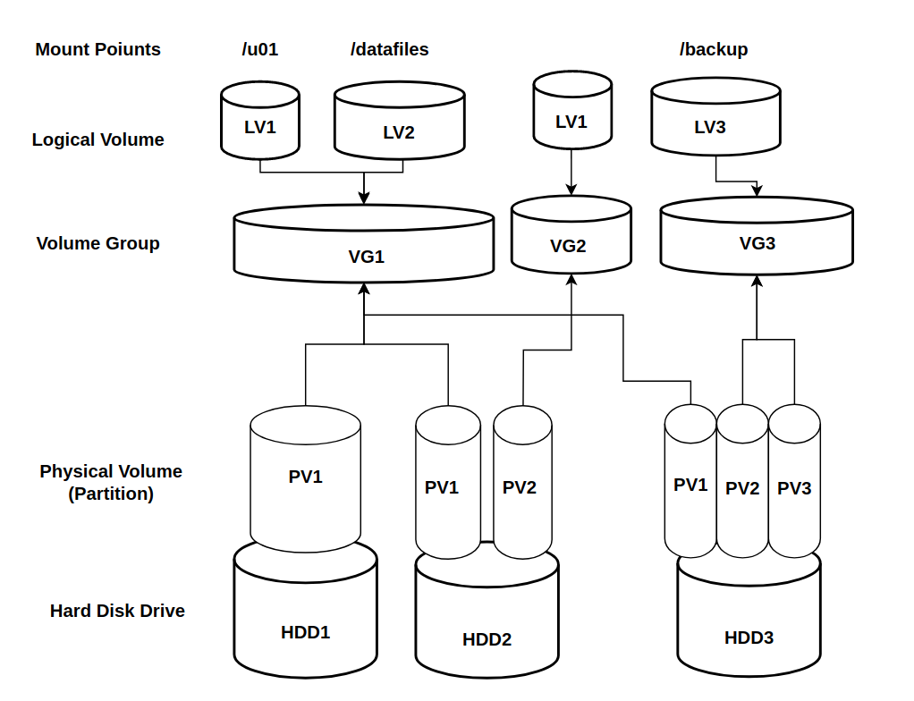

# LVM2 (Logical Volume Manager)

## Table of Contents

- [Introduction](#introduction)
- [Why Use LVM](#why-use-lvm)
- [LVM Building Blocks](#lvm-building-blocks)
- [Lab Notes](#lab-notes)
- [Create PV, VG, and LV](#create-pv-vg-and-lv)
- [Extend a VG and LV](#extend-a-vg-and-lv)
- [Shrink a Logical Volume](#shrink-a-logical-volume)
- [Migrate Data Between Physical Volumes](#migrate-data-between-physical-volumes)
- [Remove PV, VG, and LV](#remove-pv-vg-and-lv)
- [Useful Verification Commands](#useful-verification-commands)
- [Encrypt a Logical Volume (LUKS)](#encrypt-a-logical-volume-luks)

---

## Introduction

**LVM** stands for **Logical Volume Manager**. It is a Linux storage management layer that sits between physical disks and filesystems.

Instead of allocating storage directly from a fixed partition, LVM lets you:

- create storage pools from one or more disks
- carve those pools into logical volumes
- resize storage more easily as requirements change

Most modern Linux distributions support LVM natively, including root filesystems hosted on logical volumes.



---

## Why Use LVM

LVM is useful when you want storage that is easier to manage than traditional static partitions.

### Main advantages

- **Flexibility:** Extend or reduce storage with fewer limitations than standard partitions.
- **Scalability:** Add new disks to an existing volume group when capacity grows.
- **Simplified management:** Combine multiple disks into a single storage pool.
- **Migration support:** Move data between physical volumes with minimal service disruption.
- **Snapshot capability:** Create point-in-time snapshots for backup or testing workflows.

> LVM operations can be destructive if performed incorrectly. Test each procedure in a lab before using it on a production system.

---

## LVM Building Blocks

| Component | Meaning | Description |
|----------|---------|-------------|
| `PV` | Physical Volume | A disk or partition initialized for LVM use |
| `VG` | Volume Group | A storage pool made from one or more PVs |
| `LV` | Logical Volume | A virtual block device created from a VG |
| `FS` | Filesystem | The filesystem created on top of an LV, such as `ext4` or `xfs` |

The usual flow is:

1. Prepare a disk or partition.
2. Convert it into a **PV**.
3. Add the PV to a **VG**.
4. Create one or more **LVs** from the VG.
5. Create a filesystem on the LV and mount it.

---

## Lab Notes

The examples in this guide use names like:

- VG: `data_vg`
- LV: `data_lv`
- Additional LV: `lv_log` or `log_lv`
- Mount points: `/data` and `/log`

Before making changes, verify the current storage layout:

```bash
lsblk
pvs
vgs
lvs
df -h
mount | grep -E 'data|log'
```

---

## Create PV, VG, and LV

This section creates a new volume group and two logical volumes.

### 1. Review available disks

```bash
lsblk | grep -i 'sd[a-z]'
lvmdiskscan | grep -v loop
pvs
```

### 2. Partition the disks

Example:

```bash
fdisk /dev/sdb   # create /dev/sdb1 and /dev/sdb2
fdisk /dev/sdc   # create /dev/sdc1
```

### 3. Create physical volumes

```bash
pvcreate /dev/sdb1 /dev/sdc1
pvs
```

### 4. Create a volume group

```bash
vgcreate data_vg /dev/sdb1 /dev/sdc1
vgs
```

### 5. Create logical volumes

Create a 2 GB LV:

```bash
lvcreate -L 2G -n data_lv data_vg
```

Create another LV using the remaining free space:

```bash
lvcreate -l 100%FREE -n lv_log data_vg
```

### 6. Create filesystems

```bash
mkfs.ext4 /dev/mapper/data_vg-data_lv
mkfs.ext4 /dev/mapper/data_vg-lv_log
```

### 7. Create mount points and mount the LVs

```bash
mkdir /data /log
mount /dev/mapper/data_vg-data_lv /data
mount /dev/mapper/data_vg-lv_log /log
```

---

## Extend a VG and LV

Use this workflow when you need to add capacity to an existing logical volume.

### Notes

- `lvextend` only increases LV size.
- `lvresize` can increase or reduce LV size.
- For `ext4`, you can often resize the filesystem online when extending.

### 1. Check the current state

```bash
pvs
vgs
lvs
tune2fs -l /dev/data_vg/data_lv | grep resize_inode
lvmdiskscan | grep -v loop
lsblk | grep -v loop
mount | grep data_lv
df -h | grep -v "tmpfs\\|loop" | grep data_lv
```

### 2. Create a new PV and add it to the VG

```bash
pvcreate /dev/sdb2
pvs
vgextend data_vg /dev/sdb2
pvs
vgs
```

### 3. Extend the LV

Automatic resize of LV and filesystem:

```bash
lvresize --resizefs -L +1G /dev/mapper/data_vg-data_lv
```

Manual method:

```bash
lvextend -L 4G /dev/mapper/data_vg-data_lv
resize2fs /dev/data_vg/data_lv
```

Use all remaining free space:

```bash
lvextend -l +100%FREE /dev/mapper/data_vg-data_lv
lvresize -r -l +100%FREE /dev/mapper/data_vg-data_lv
```

### 4. Verify the result

```bash
vgs
lvs
df -h | grep -v "tmpfs\\|loop" | grep data_lv
```

---

## Shrink a Logical Volume

Shrinking is more risky than extending. You must understand both layers involved:

- the **filesystem**
- the **logical volume**

If you reduce the LV before shrinking the filesystem, you can corrupt data.

### Important limitations

- `ext4` can be shrunk, but normally requires the filesystem to be unmounted first.
- `xfs` does **not** support shrinking.

### Before shrinking

Confirm all of the following:

- the filesystem type
- the used and free space
- the target size after shrink

Useful checks:

```bash
vgs
lvs
df -h | grep -v 'loop\\|tmpfs'
mount | grep -i data
```

### Method 1: Shrink `ext4` with `lvresize --resizefs`

```bash
umount /data
lvresize --resizefs --size 2G /dev/data_vg/data_lv
mount /dev/mapper/data_vg-data_lv /data
df -h | grep -v 'loop\\|tmpfs'
```

### Method 2: Manual shrink

Example for `/dev/mapper/data_vg-log_lv` mounted on `/logs`:

```bash
umount /logs
e2fsck -f /dev/mapper/data_vg-log_lv
resize2fs /dev/mapper/data_vg-log_lv 2G
lvreduce -L 2G /dev/mapper/data_vg-log_lv
mount /dev/mapper/data_vg-log_lv /logs
```

### Verify after shrink

```bash
lvs data_vg
df -h | grep -v 'loop\\|tmpfs'
```

---

## Migrate Data Between Physical Volumes

LVM supports moving extents from one physical volume to another using `pvmove`.

Typical reasons for migration:

- reclaim a disk or partition
- replace a failing disk
- move data to a larger disk

### 1. Review current allocation

```bash
lsblk | grep -v loop
vgs -o+devices | grep data_vg
lvs -o+devices data_vg
df -h | grep -v 'loop\\|tmpfs'
pvs -o+pv_used
pvs -o+pv_used | grep -i data_vg
```

### 2. Move data from one PV to another existing PV

```bash
pvmove /dev/sdb1 /dev/sdc1
pvmove /dev/sdb2 /dev/sdc1
pvs -o+pv_used
lsblk | grep -v loop
```

### 3. Migrate to a newly added disk

Partition the new disk first:

```bash
fdisk /dev/sdd   # create /dev/sdd1
```

Create the PV and extend the VG:

```bash
pvcreate /dev/sdd1
pvs
vgs
vgextend data_vg /dev/sdd1
pvs
vgs
```

Move data and remove old PVs from the VG:

```bash
pvmove /dev/sd[bc][12]
vgreduce data_vg /dev/sd[bc][12]
pvs -o+pv_used
```

---

## Remove PV, VG, and LV

This procedure destroys data. Make sure all important data is backed up before continuing.

### 1. Confirm what is mounted

```bash
df -h | grep -v 'loop\\|tmpfs' | grep data
lvs data_vg
lsblk | grep -v loop
mount | grep data_vg
```

### 2. Unmount filesystems

```bash
umount /data /logs
mount | grep data_vg
```

### 3. Remove logical volumes

```bash
lvs data_vg
lvremove -f /dev/data_vg/data_lv /dev/data_vg/log_lv
lvs data_vg
```

### 4. Remove the volume group

```bash
vgs data_vg
pvs
vgremove data_vg
vgs
```

### 5. Remove physical volumes

```bash
pvs
pvremove /dev/sdb1 /dev/sdb2 /dev/sdc1 /dev/sdd1
# or:
pvremove /dev/sd[bcd][12]
pvs
lsblk | grep -v loop
```

### 6. Remove disk partitions if required

```bash
fdisk /dev/sdb
fdisk /dev/sdc
fdisk /dev/sdd
lsblk | grep -v loop
```

---

## Useful Verification Commands

Keep these commands handy during LVM administration:

```bash
lsblk
lvmdiskscan | grep -v loop

pvs
vgs
lvs

vgs -o+devices
lvs -o+devices
pvs -o+pv_used

df -h
mount
```

---

## Encrypt a Logical Volume (LUKS)

LUKS (Linux Unified Key Setup) is the standard disk encryption layer on Linux. You apply it on top of an existing logical volume before creating a filesystem. At boot, the system reads a keyfile to unlock the LUKS container automatically — no password prompt required.

> **Warning:** Encryption is applied to an **empty** LV. Never run `cryptsetup luksFormat` on an LV that already contains data — it will be destroyed.

### Overview

The setup has three layers:

```
LVM Logical Volume  (/dev/data_vg/secure_lv)
        |
   LUKS container   (cryptsetup)
        |
    Filesystem       (ext4 / xfs)
        |
    Mount point      (/secure)
```

Automatic unlock at boot requires two files:
- `/etc/crypttab` — tells the system which LUKS device to open and which keyfile to use
- `/etc/fstab` — mounts the unlocked device to a mount point

---

### Prerequisites

Install `cryptsetup` if not already present:

```bash
# RHEL / Oracle Linux / Fedora
sudo dnf install -y cryptsetup

# Debian / Ubuntu
sudo apt install -y cryptsetup
```

---

### Step 1: Create the Logical Volume

Create a dedicated LV for encrypted data. This example creates a 5 GB LV named `secure_lv` inside the existing `data_vg` volume group.

```bash
lvcreate -L 5G -n secure_lv data_vg
lvs data_vg
```

---

### Step 2: Format the LV with LUKS2

This initializes the LUKS container. You will be prompted to set an **initial passphrase** — this is used temporarily to add the keyfile in the next step.

```bash
cryptsetup luksFormat --type luks2 /dev/data_vg/secure_lv
```

Confirm the LUKS header was written:

```bash
cryptsetup luksDump /dev/data_vg/secure_lv
```

---

### Step 3: Create a Keyfile

A keyfile is a binary file used in place of a passphrase for automatic unlocking. Store it on the root filesystem with restricted permissions.

```bash
# Create the directory for keyfiles
mkdir -p /etc/luks-keys
chmod 700 /etc/luks-keys

# Generate a 4096-byte random keyfile
dd if=/dev/urandom of=/etc/luks-keys/secure_lv.key bs=512 count=8
chmod 600 /etc/luks-keys/secure_lv.key
```

---

### Step 4: Add the Keyfile to the LUKS Container

LUKS supports up to 32 key slots. Add your keyfile to slot 1 (slot 0 holds the passphrase you set during format).

```bash
cryptsetup luksAddKey /dev/data_vg/secure_lv /etc/luks-keys/secure_lv.key
```

Verify both key slots are populated:

```bash
cryptsetup luksDump /dev/data_vg/secure_lv | grep -i "key slot"
```

> **Optional:** Once the keyfile is verified to work at boot, you can remove the passphrase from slot 0 to enforce keyfile-only access:
> ```bash
> cryptsetup luksKillSlot /dev/data_vg/secure_lv 0
> ```

---

### Step 5: Open the LUKS Container

Open the container manually for the first time to create the `/dev/mapper` device:

```bash
cryptsetup luksOpen /dev/data_vg/secure_lv secure_data \
  --key-file /etc/luks-keys/secure_lv.key
```

Confirm the mapped device exists:

```bash
ls -l /dev/mapper/secure_data
cryptsetup status secure_data
```

---

### Step 6: Create a Filesystem

```bash
mkfs.ext4 /dev/mapper/secure_data
```

---

### Step 7: Mount and Verify

```bash
mkdir -p /secure
mount /dev/mapper/secure_data /secure
df -h /secure
```

---

### Step 8: Configure /etc/crypttab (Auto-Unlock at Boot)

`/etc/crypttab` tells `systemd` which LUKS device to open at boot and which keyfile to use.

```bash
vim /etc/crypttab
```

Add the following line:

```
# <name>       <device>                              <keyfile>                        <options>
secure_data     /dev/data_vg/secure_lv               /etc/luks-keys/secure_lv.key     luks
```

| Field     | Value                              | Description                              |
|-----------|------------------------------------|------------------------------------------|
| `name`    | `secure_data`                      | The name of the mapped device under `/dev/mapper/` |
| `device`  | `/dev/data_vg/secure_lv`           | The underlying LUKS-encrypted LV         |
| `keyfile` | `/etc/luks-keys/secure_lv.key`     | Path to the keyfile for auto-unlock      |
| `options` | `luks`                             | Specifies LUKS format                    |

> You can also use the LV's UUID instead of the device path for reliability:
> ```bash
> blkid /dev/data_vg/secure_lv
> # Use the UUID in crypttab:
> secure_data   UUID=<uuid-here>   /etc/luks-keys/secure_lv.key   luks
> ```

---

### Step 9: Configure /etc/fstab (Auto-Mount at Boot)

Add an entry to mount the unlocked device after it is opened by `crypttab`.

```bash
vim /etc/fstab
```

Add the following line:

```
# <device>                   <mount point>   <type>   <options>         <dump>  <pass>
/dev/mapper/secure_data       /secure         ext4     defaults,noatime  0       2
```

| Field          | Value                   | Description                                              |
|----------------|-------------------------|----------------------------------------------------------|
| `device`       | `/dev/mapper/secure_data` | The mapped device name matching `crypttab`             |
| `mount point`  | `/secure`               | Where to mount the decrypted volume                      |
| `type`         | `ext4`                  | Filesystem type used when formatting                     |
| `options`      | `defaults,noatime`      | Standard mount options; `noatime` reduces write overhead |
| `dump`         | `0`                     | Not included in `dump` backups                           |
| `pass`         | `2`                     | `fsck` check order (2 = checked after root)              |

---

### Step 10: Test the Full Boot Sequence

Unmount and close the LUKS container, then simulate a clean boot mount:

```bash
# Unmount
umount /secure

# Close the LUKS container
cryptsetup luksClose secure_data

# Re-open using crypttab keyfile (simulates what systemd does at boot)
cryptsetup luksOpen /dev/data_vg/secure_lv secure_data \
  --key-file /etc/luks-keys/secure_lv.key

# Re-mount using fstab entry
mount /secure

# Verify
df -h /secure
ls /secure
```

Or simply reboot and verify the volume is mounted automatically:

```bash
reboot
# after login:
df -h /secure
lsblk
```

---

### Quick Reference

```bash
# Show LUKS header info
cryptsetup luksDump /dev/data_vg/secure_lv

# List active LUKS mappings
cryptsetup status secure_data

# Open LUKS container manually with keyfile
cryptsetup luksOpen /dev/data_vg/secure_lv secure_data \
  --key-file /etc/luks-keys/secure_lv.key

# Close LUKS container (must unmount first)
umount /secure
cryptsetup luksClose secure_data

# Add a new keyfile to an existing LUKS container
cryptsetup luksAddKey /dev/data_vg/secure_lv /etc/luks-keys/new.key

# Remove a key slot (e.g. remove passphrase from slot 0)
cryptsetup luksKillSlot /dev/data_vg/secure_lv 0

# Show block device with encryption info
lsblk -o NAME,SIZE,TYPE,FSTYPE,MOUNTPOINT
```
